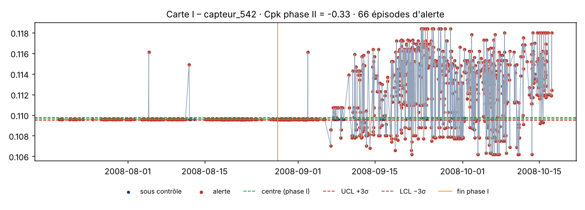
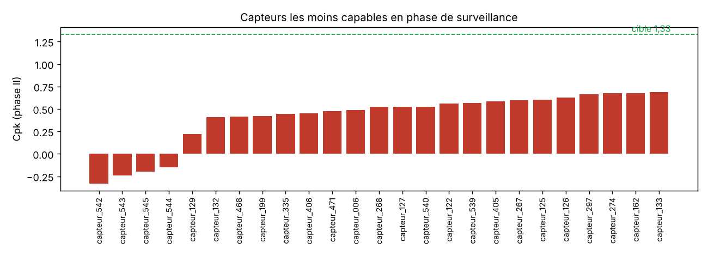
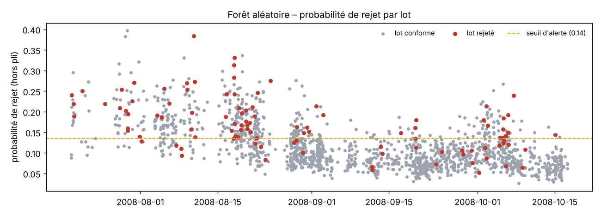

# Supervision SPC et détection d'anomalies sur une ligne de test industrielle

Pipeline Python complet appliqué aux données publiques **SECOM** (UCI) : 1 567 lots d'une ligne de fabrication de semi-conducteurs, 590 mesures capteurs par lot et le verdict du test final (conforme / rejeté), sur trois mois de production.

Objectif : reproduire ce qu'attend une équipe Qualité d'un outil de supervision de lignes d'assemblage automatisées.

1. **Collecter et nettoyer** les données issues des testeurs automatiques, et les stocker en base SQL.
2. **Surveiller statistiquement** chaque capteur : cartes de contrôle, indices de capabilité Cp/Cpk, règles de détection de dérive.
3. **Alerter de façon préventive** : repérer les lots à risque avant le verdict du test (détection d'anomalies et modèle prédictif).
4. **Restituer** le tout dans un tableau de bord interactif pour les équipes Qualité et Production.



## Résultats

| Étape | Résultat |
|---|---|
| Nettoyage | 442 capteurs conservés sur 590 (32 trop incomplets, 116 constants) ; imputation par la médiane, écrêtage des 0,5 % extrêmes |
| SPC phase II | Cpk médian 1,30 ; **250 capteurs sur 442 sous la cible de 1,33** ; 29 049 épisodes d'alerte, dont 1 217 tendances |
| Prédiction du rejet (forêt aléatoire, validation croisée 5 plis) | **AUC ROC 0,77**, précision moyenne 0,18 (taux de base 0,066, soit × 2,7) ; au seuil retenu : **rappel 69 %, précision 16 %** |
| Même modèle, découpage temporel (75 % / 25 %) | AUC ROC 0,53 |
| Détection non supervisée | AUC 0,54 (Isolation Forest), 0,59 (statistique SPE) |

Trois enseignements, qui sont aussi les points à discuter avec un process :

- **Le procédé dérive.** Les capteurs 542 à 545 sont parfaitement stables pendant la phase de référence puis changent brutalement de régime début septembre (Cpk de 1,3 à −0,33). Le SPC le voit immédiatement ; un modèle appris sur le passé non.
- **Cette dérive explique l'écart entre les deux évaluations du modèle.** 0,77 d'AUC en validation croisée, 0,53 en découpage temporel : les relations capteurs → rejet apprises sur juillet-août ne tiennent plus en octobre. En production, le modèle devrait être réentraîné à chaque changement de régime détecté par le SPC.
- **Un lot rejeté n'est pas un lot atypique.** Les méthodes non supervisées, qui cherchent des profils capteurs inhabituels, sont à peine meilleures que le hasard ; le rejet dépend de quelques capteurs précis (59, 103, 33, 130…), que seul l'apprentissage supervisé isole.




## Méthode

**Nettoyage** (`cleaning.py`). Suppression des capteurs ayant plus de 30 % de valeurs manquantes ou une variance nulle, imputation par la médiane, winsorisation à 0,5 % / 99,5 % pour neutraliser les erreurs de mesure isolées. Un rapport de nettoyage est conservé dans `metrics.json`.

**SPC** (`spc.py`). Démarche en deux phases, comme sur une ligne réelle :

- *Phase I* : les 30 % premiers lots fixent le centre et la dispersion de référence. L'écart-type est estimé par l'étendue mobile moyenne (carte I-MR, `sigma = MR / d2`, `d2 = 1,128`). Faute de tolérances publiées, les limites de spécification sont posées à `mu_ref ± 4 sigma_ref`, ce qui vaut un Cpk de 1,33 pour un procédé qui resterait identique à lui-même.
- *Phase II* : les lots suivants sont comparés à ces références ; Cp et Cpk y sont recalculés, de sorte qu'une chute de Cpk signale un décentrage ou une dispersion accrue.
- Trois règles de dérive, dérivées des règles Western Electric : point hors ± 3σ, 8 points consécutifs du même côté du centre, 6 points consécutifs monotones. Les points en alerte sont regroupés en **épisodes** (une séquence continue = un événement à traiter), avec le nombre de lots rejetés pendant l'épisode.

**Prédiction du rejet** (`anomaly.py`). Forêt aléatoire avec pondération des classes (6,6 % de rejets). Deux protocoles d'évaluation : validation croisée stratifiée à 5 plis (mesure stable, exploite les 104 rejets) et découpage temporel 75 / 25 (proche du déploiement). Le seuil de décision n'est pas 0,5 : il maximise la précision sous contrainte d'un rappel d'au moins 60 %, car laisser passer un lot défaillant coûte plus cher qu'une fausse alerte. Deux scores non supervisés sont calculés pour comparaison : Isolation Forest et SPE (erreur de reconstruction d'une ACP à 30 composantes).

**Tableau de bord** (`dashboard.py`). Page HTML autonome : indicateurs clés, carte de contrôle avec sélection du capteur, Cpk des capteurs les moins capables, probabilité de rejet par lot avec le seuil d'alerte, capteurs les plus explicatifs. Les données sont embarquées en JSON, les graphiques sont tracés par Plotly.js dans le navigateur.

## Structure

```
.
├── run_pipeline.py            # point d'entrée : exécute les cinq étapes
├── src/secom_spc/
│   ├── io.py                  # lecture SECOM, écriture SQLite
│   ├── cleaning.py            # nettoyage des capteurs
│   ├── spc.py                 # cartes I-MR, Cp/Cpk, règles, épisodes
│   ├── anomaly.py             # scores non supervisés, forêt aléatoire, seuil
│   └── dashboard.py           # tableau de bord HTML
├── scripts/figures.py         # figures statiques du README
├── tests/                     # tests unitaires (pytest)
├── data/raw/                  # secom.data, secom_labels.data (non versionnés)
├── outputs/                   # livrables générés
└── docs/                      # figures
```

Livrables générés dans `outputs/` : `dashboard.html`, `spc_capabilite.csv` (une ligne par capteur), `episodes_alerte_spc.csv`, `probabilites_rejet.csv`, `scores_non_supervises.csv`, `importance_capteurs.csv`, `metrics.json`, `secom.db`.

## Installation et exécution

```bash
git clone https://github.com/YessineBouattour/secom-spc-anomalies.git
cd secom-spc-anomalies
python -m venv .venv && source .venv/bin/activate      # Windows : .venv\Scripts\activate
pip install -r requirements.txt
```

Télécharger `secom.zip` depuis la page du jeu de données ([archive.ics.uci.edu/dataset/179/secom](https://archive.ics.uci.edu/dataset/179/secom)) et placer `secom.data` et `secom_labels.data` dans `data/raw/`.

```bash
python run_pipeline.py             # ≈ 1 min ; écrit les livrables dans outputs/
python scripts/figures.py          # figures du README
python -m pytest tests             # tests unitaires
```

Ouvrir ensuite `outputs/dashboard.html` dans un navigateur.

## Limites et suites possibles

- Les tolérances `± 4 sigma` sont une convention faute de spécifications réelles ; sur une ligne, elles seraient remplacées par les tolérances du plan de contrôle.
- Les règles de dérive supposent des mesures indépendantes et à peu près gaussiennes ; plusieurs capteurs SECOM ne le sont pas, d'où un nombre élevé d'épisodes courts. Une carte EWMA ou une transformation préalable réduirait ces fausses alertes.
- Les capteurs sont anonymes : impossible de rattacher les alertes à un équipement. Avec les métadonnées d'une ligne réelle, on agrégerait les alertes par poste.
- Le réentraînement du modèle prédictif devrait être déclenché par les changements de régime détectés en SPC.

## Données

M. McCann et A. Johnston, *SECOM Data Set*, UCI Machine Learning Repository, 2008. Licence CC BY 4.0.
